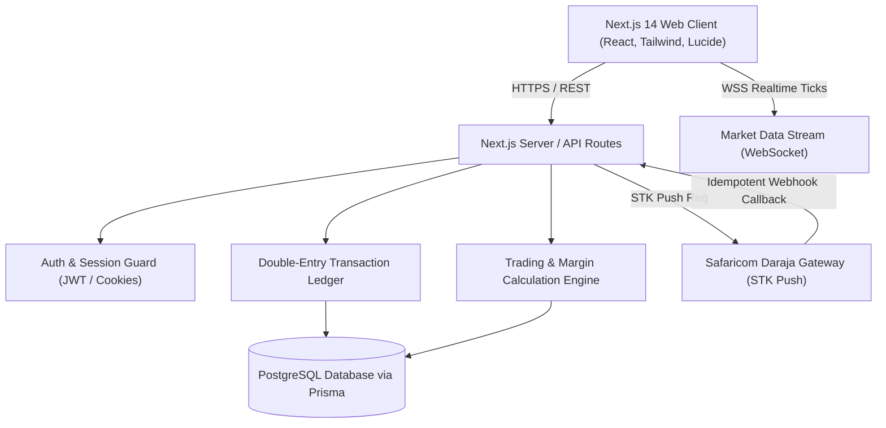

# TRADEPEDIA — System Architecture

## 1. Architectural Layers

### Frontend Layer
- **Framework**: Next.js 14 App Router, TypeScript, React 18.
- **Styling**: Tailwind CSS with custom dark financial trading theme, lucide-react icons.
- **State Management**: React Server Components paired with minimal, robust client state for live quotes, forms, and portfolio tabs.
- **Real-Time Layer**: WebSocket client for live Forex prices (EUR/USD, GBP/USD, USD/JPY, etc.).

### Application / API Layer
- **Endpoints**: Next.js API route handlers (`/api/*`).
- **Validation**: Strict schema validation using Zod for all incoming JSON payloads and URL parameters.
- **Security & Middleware**: Role-based access control, CSRF mitigation, HTTP-only SameSite cookies, input sanitation.
- **Ledger Invariant**: No balance update is ever executed without an accompanying atomic `LedgerEntry` record created inside a database transaction (`prisma.$transaction`).

### Integration Layer
- **M-Pesa Daraja Gateway**: Direct integration with Safaricom M-Pesa Express (STK Push) with OAuth token caching, nonce hashing, and webhook reconciliation.
- **Storage**: Private object storage abstraction for sensitive KYC identity documents.

### Persistence Layer
- **Database**: PostgreSQL with Prisma ORM.
- **Numeric Precision**: Fixed-point Decimal types (`@db.Decimal(18, 2)` for currency amounts; `@db.Decimal(18, 8)` for Forex exchange rates and pips). Floating point arithmetic is strictly forbidden for financial calculations.
