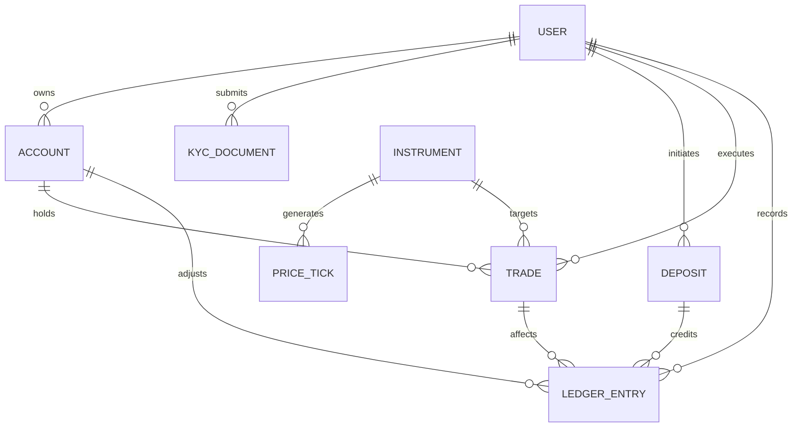

# TRADEPEDIA — Database Schema Specification

## 1. Design Principles
- **No Float for Money**: All financial values, account balances, and price rates utilize fixed-point PostgreSQL Decimal (`@db.Decimal(18, 2)` or `@db.Decimal(18, 8)`).
- **Auditability**: Every mutation to an account balance must have an immutable `LedgerEntry` record linked to it.
- **Foreign Exchange Precision**: Instrument pricing supports 8 decimal places for pip accuracy (e.g., JPY pairs vs USD pairs).
- **Strict KYC Gating**: User accounts have dedicated KYC document records with review states.

## 2. Entity-Relationship Diagram

## 3. Enums and Models

### Enums
- `UserRole`: `USER`, `ADMIN`, `COMPLIANCE`
- `KycStatus`: `NOT_SUBMITTED`, `PENDING`, `APPROVED`, `REJECTED`
- `DepositStatus`: `INITIATED`, `PENDING_CONFIRMATION`, `SUCCESSFUL`, `FAILED`, `CANCELLED`, `EXPIRED`
- `TradeStatus`: `OPEN`, `CLOSED`, `CANCELLED`, `REJECTED`
- `TradeDirection`: `BUY`, `SELL`
- `LedgerEntryType`: `DEPOSIT`, `TRADE_OPEN_MARGIN_HOLD`, `TRADE_CLOSE_MARGIN_RELEASE`, `TRADE_PROFIT`, `TRADE_LOSS`, `FEE`, `ADJUSTMENT`, `WITHDRAWAL` (reserved for future withdrawal phase)

### Core Models
1. **User**:
   - `id`: CUID Primary Key
   - `email`: Unique string
   - `phone`: Unique international string (e.g., `+254...`)
   - `passwordHash`: Bcrypt hash (cost factor 10+)
   - `fullName`: String
   - `role`: UserRole
   - `kycStatus`: KycStatus
   - `isActive`: Boolean flag

2. **Account**:
   - `id`: CUID Primary Key
   - `userId`: FK to User
   - `currency`: Default "KES"
   - `availableBalance`: Decimal(18, 2)
   - `lockedMargin`: Decimal(18, 2)
   - `equity`: Decimal(18, 2)
   - `isDemo`: Boolean

3. **KycDocument**:
   - `id`: CUID Primary Key
   - `userId`: FK to User
   - `documentType`: National ID, Passport, Alien Card, Proof of Address, Selfie
   - `fileUrl`: Secure storage URL
   - `status`: KycStatus
   - `reviewerNote`: Optional reviewer commentary
   - `reviewedBy`: Admin user ID
   - `reviewedAt`: Timestamp

4. **Deposit**:
   - `id`: CUID Primary Key
   - `userId`: FK to User
   - `accountId`: FK to Account
   - `amount`: Decimal(18, 2)
   - `phoneNumber`: String
   - `status`: DepositStatus
   - `merchantRequestId`: Safaricom identifier
   - `checkoutRequestId`: Unique Safaricom session identifier
   - `mpesaReceiptNumber`: Unique M-Pesa transaction reference (e.g. `QWE123RTY4`)
   - `callbackPayload`: Json raw webhook response

5. **Instrument**:
   - `id`: CUID Primary Key
   - `symbol`: e.g. `EURUSD`, `GBPUSD`, `USDJPY`
   - `pipSize`: Decimal(18, 8) (e.g. `0.0001` or `0.01` for JPY)
   - `contractSize`: Decimal(18, 8) (e.g. `100000`)
   - `maxLeverage`: Default `10`
   - `isActive`: Boolean

6. **Trade**:
   - `id`: CUID Primary Key
   - `direction`: BUY or SELL
   - `lotSize`: Decimal(18, 4)
   - `entryPrice`: Decimal(18, 8)
   - `exitPrice`: Decimal(18, 8)
   - `stopLoss`: Decimal(18, 8)
   - `takeProfit`: Decimal(18, 8)
   - `marginRequired`: Decimal(18, 2)
   - `pnl`: Decimal(18, 2)
   - `status`: TradeStatus

7. **LedgerEntry**:
   - `id`: CUID Primary Key
   - `userId`: FK to User
   - `accountId`: FK to Account
   - `type`: LedgerEntryType
   - `amount`: Decimal(18, 2) (signed or delta)
   - `balanceAfter`: Decimal(18, 2)
   - `referenceType`: DEPOSIT, TRADE, ADJUSTMENT, etc.
   - `referenceId`: Identifier of source entity
   - `description`: Audit explanation string

8. **AuditLog**:
   - `id`: CUID Primary Key
   - `actorId`: User ID who initiated action
   - `action`: Action verb
   - `entityType`: Subject entity
   - `entityId`: Subject ID
   - `metadata`: JSON details
   - `ipAddress`: Client IP
