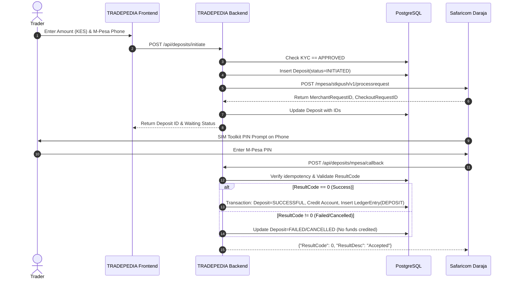

# Safaricom Daraja M-Pesa Integration Specification

TRADEPEDIA integrates with Safaricom's Daraja 2.0 API using **M-Pesa Express (STK Push)**.

## 1. Credentials and Environment Variables
```env
MPESA_ENV=sandbox # or "production"
MPESA_CONSUMER_KEY="your_consumer_key"
MPESA_CONSUMER_SECRET="your_consumer_secret"
MPESA_SHORTCODE="174379" # Paybill / Till Number
MPESA_PASSKEY="bfb279f9aa9bdbcf158e97dd71a467cd2e0c893059b10f78e6b72ada1ed2c919"
MPESA_CALLBACK_URL="https://tradepedia.co.ke/api/deposits/mpesa/callback"
```

## 2. Token Generation & Caching
Daraja OAuth tokens are generated via HTTP Basic Auth against:
- Sandbox: `https://sandbox.safaricom.co.ke/oauth/v1/generate?grant_type=client_credentials`
- Production: `https://api.safaricom.co.ke/oauth/v1/generate?grant_type=client_credentials`

Tokens expire in 3599 seconds. The backend caches the Bearer token in memory/Redis and refreshes 60 seconds prior to expiration.

## 3. STK Push Workflow



## 4. Idempotency & Security Safeguards
1. **Never Collect PINs**: TRADEPEDIA never prompts, handles, or stores M-Pesa user PINs. The user enters their PIN strictly inside Safaricom's encrypted SIM toolkit prompt.
2. **Never Credit on Client Signal**: Balances are NEVER credited based on frontend responses. Crediting requires cryptographically signed or callback verified server-side reconciliation.
3. **Idempotent Webhook Processing**:
   - Each deposit callback is verified against `checkoutRequestId` and `mpesaReceiptNumber`.
   - If a callback has already been marked `SUCCESSFUL`, subsequent callback deliveries return `ResultCode: 0` immediately without duplicating ledger entries or account balance additions.
4. **Phone Formatting**: Kenyan phone numbers are normalized to E.164 without plus: `2547XXXXXXXX` or `2541XXXXXXXX`.
5. **Reconciliation Worker**:
   - A background cron queries Daraja Query API (`/mpesa/stkpushquery/v1/query`) for any deposits remaining in `INITIATED` status past 5 minutes to settle timed-out or dropped webhooks.
